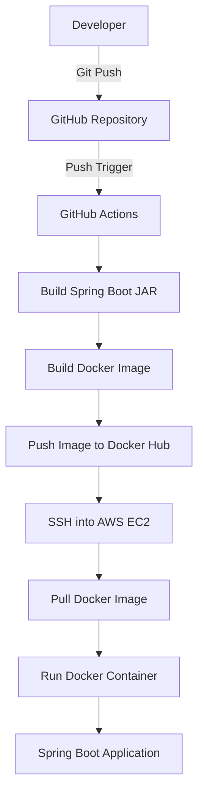

## Architecture

This project implements an automated CI/CD pipeline using
GitHub Actions, Docker, Docker Hub and AWS EC2.

## Project Overview

This project demonstrates an end-to-end CI/CD pipeline for a Java Spring Boot application using GitHub Actions, Docker, Docker Hub and AWS EC2.

The application is automatically built and packaged into a JAR file. GitHub Actions then builds a Docker image and pushes it to Docker Hub.

Using SSH, GitHub Actions connects to the AWS EC2 instance, pulls the latest Docker image, replaces the existing container and starts the updated application.

**Key features:**
- Automated application build using Maven.
- Docker image creation and publishing.
- GitHub Actions workflow triggered by code pushes.
- Secure SSH-based deployment to AWS EC2.
- Containerized Spring Boot application.

**Application endpoint:**

`http://<EC2-PUBLIC-IP>:8080/api/welcome`

Replace the placeholder with your EC2 public IP.
